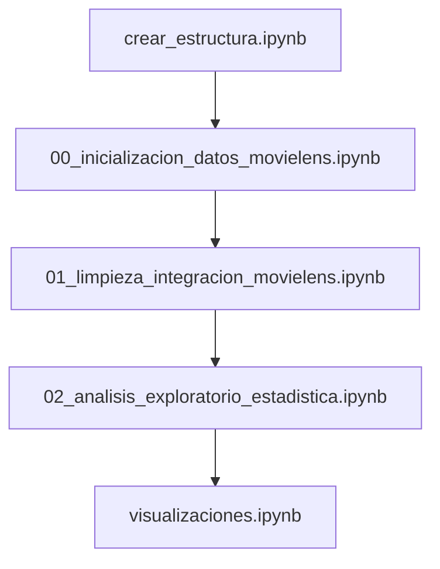

# Proyecto Integrador — DMEMCD

## 1. Descripción del proyecto

El presente proyecto tiene como propósito desarrollar un análisis descriptivo, exploratorio y estadístico del conjunto de datos **MovieLens 32M**, con el fin de comprender los patrones de calificación, las características de las películas y el comportamiento de los usuarios dentro de la plataforma.

A través de un flujo de trabajo organizado en notebooks de Jupyter, se desarrollan distintas etapas que abarcan desde la configuración inicial del entorno y la adquisición de los datos hasta su limpieza, integración, exploración y visualización.

El análisis busca identificar distribuciones, tendencias, relaciones y patrones relevantes en la información disponible, utilizando herramientas de ciencia de datos para generar conocimiento fundamentado en evidencia.

El proyecto prioriza la reproducibilidad, la automatización de tareas y la organización estructurada del código y los datos, de manera que los integrantes del equipo puedan ejecutar y consultar el proceso bajo condiciones de trabajo homogéneas.

## 2. Objetivos del proyecto

### Objetivo general

Analizar el conjunto de datos **MovieLens 32M** mediante técnicas de análisis descriptivo, exploratorio y estadístico, con el propósito de identificar patrones de comportamiento de los usuarios, características de las películas y tendencias en las calificaciones registradas. El análisis se orienta a responder la siguiente pregunta central:

**¿Qué patrones caracterizan las calificaciones de las películas en MovieLens 32M y cómo se relacionan con su popularidad, género y año de estreno, considerando la estabilidad de las valoraciones según el número de evaluaciones recibidas?**

### Objetivos específicos

- Configurar un entorno de trabajo reproducible y una estructura organizada para el almacenamiento de información.
- Automatizar la adquisición, extracción y validación de integridad de los datos.
- Examinar la estructura, las características y la calidad de los conjuntos de datos.
- Identificar y tratar posibles inconsistencias, valores ausentes y registros duplicados.
- Integrar las diferentes tablas mediante sus identificadores y relaciones correspondientes.
- Desarrollar análisis exploratorios para estudiar el comportamiento de usuarios, películas y calificaciones.
- Generar visualizaciones que faciliten la interpretación de los resultados.
- Documentar los procedimientos y hallazgos para facilitar su consulta y reproducibilidad.

## 3. Flujo de trabajo

El proyecto se organiza mediante una secuencia de notebooks que representan las principales etapas del procesamiento y análisis de los datos.

### Secuencia de ejecución



### Descripción de los notebooks

| Notebook | Propósito |
|---|---|
| `crear_estructura.ipynb` | Configuración inicial y creación de la estructura de directorios del proyecto. |
| `00_inicializacion_datos_movielens.ipynb` | Adquisición, extracción, validación, carga e inspección inicial de MovieLens 32M. |
| `01_limpieza_integracion_movielens.ipynb` | Limpieza, preparación e integración de los conjuntos de datos. |
| `02_analisis_exploratorio_estadistica.ipyn` | Documentar las propiedades identificadas en tablas consolidadas y los principales insights obtenidos. |
| `visualizaciones.ipynb` | Desarrollo de visualizaciones para explorar e interpretar los resultados del análisis. |

**Orden de ejecución:** los notebooks deben ejecutarse siguiendo la secuencia establecida, ya que las etapas posteriores pueden depender de los archivos o resultados generados previamente.

## 4. Estructura del repositorio

El proyecto mantiene una organización modular que separa los datos, el código de análisis, las funciones reutilizables y los resultados generados.

```text
DMEMCD/
│
├── data/
│   ├── raw/
│   │   └── ml-32m/
│   ├── processed/
│   └── external/
│
├── models/
│
├── notebooks/
│   ├── crear_estructura.ipynb
│   ├── 00_inicializacion_datos_movielens.ipynb
│   ├── 01_limpieza_integracion_movielens.ipynb
│   └── visualizaciones.ipynb
│
├── reports/
│
├── src/
│
├── requirements.txt
└── README.md
```

### Descripción de los directorios

| Directorio | Descripción |
|---|---|
| `data/raw/` | Almacena los datos originales, conservando su contenido sin modificaciones. |
| `data/raw/ml-32m/` | Contiene los archivos originales correspondientes a MovieLens 32M. |
| `data/processed/` | Almacena los conjuntos de datos resultantes de los procesos de limpieza y transformación. |
| `data/external/` | Reserva destinada a fuentes de información complementarias. |
| `models/` | Espacio destinado al almacenamiento de modelos estadísticos o predictivos, en caso de desarrollarse. |
| `notebooks/` | Contiene los notebooks utilizados para la adquisición, preparación, exploración y análisis de los datos. |
| `reports/` | Almacena reportes, resultados y recursos visuales generados durante el proyecto. |
| `src/` | Contiene funciones y módulos reutilizables para evitar duplicación de código. |

## 5. Tecnologías y herramientas

El desarrollo del proyecto utiliza las siguientes tecnologías y bibliotecas:

| Tecnología | Aplicación |
|---|---|
| Python | Lenguaje principal de programación. |
| Jupyter Notebook | Entorno interactivo para documentar y ejecutar los análisis. |
| Pandas | Manipulación, transformación e integración de datos tabulares. |
| NumPy | Operaciones numéricas y procesamiento de datos. |
| Matplotlib | Construcción de visualizaciones y gráficos estadísticos. |
| Scikit-learn | Herramientas para procesamiento y posibles desarrollos de análisis predictivo. |

Las dependencias del proyecto se encuentran centralizadas en el archivo `requirements.txt`.


## 7. Fuente y adquisición de los datos

Este proyecto utiliza el conjunto de datos **MovieLens 32M**, desarrollado por GroupLens Research, perteneciente a la University of Minnesota.

**Fuente oficial:**

https://grouplens.org/datasets/movielens/

MovieLens 32M contiene información sobre películas, usuarios, calificaciones y etiquetas, lo que permite estudiar diferentes aspectos del comportamiento de evaluación y la interacción de los usuarios con el catálogo cinematográfico.

### 6.1. Descarga de los datos

Los archivos originales deben obtenerse desde la fuente oficial de GroupLens y colocarse en el siguiente directorio:

```text
data/raw/ml-32m/
```

La estructura esperada del conjunto de datos es:

```text
ml-32m/
├── ratings.csv
├── tags.csv
├── movies.csv
├── links.csv
├── README.txt
└── checksums.txt
```

### 6.2. Descripción de los archivos

| Archivo | Contenido |
|---|---|
| `movies.csv` | Catálogo de películas y sus géneros. |
| `ratings.csv` | Calificaciones numéricas asignadas por los usuarios. |
| `tags.csv` | Etiquetas textuales asociadas a las películas por los usuarios. |
| `links.csv` | Correspondencias entre identificadores de MovieLens, IMDb y TMDb. |
| `README.txt` | Documentación descriptiva del conjunto de datos. |
| `checksums.txt` | Valores hash de referencia para verificar la integridad de los archivos. |

### 6.3. Consideraciones sobre los datos

- Los archivos originales no se incluyen en este repositorio debido a su tamaño y para optimizar su distribución.
- Los datos deben conservarse en `data/raw/ml-32m/` para mantener la compatibilidad con las rutas utilizadas en los notebooks.
- Los archivos originales deben mantenerse sin modificaciones; cualquier transformación deberá almacenarse en `data/processed/`.
- La integridad de los archivos debe verificarse antes de iniciar su procesamiento.
- La descarga debe realizarse desde la fuente oficial para garantizar la correspondencia con la versión utilizada durante el desarrollo.

## 7. Reproducibilidad y organización del trabajo

El proyecto busca mantener un flujo de trabajo reproducible mediante las siguientes prácticas:

- **Estructura centralizada:** los datos, notebooks, módulos y resultados se almacenan en directorios específicos.
- **Automatización:** las operaciones de configuración, adquisición y preparación de los datos se ejecutan mediante código.
- **Separación de datos:** se conservan los archivos originales y se almacenan por separado los resultados del procesamiento.
- **Control de dependencias:** las bibliotecas necesarias se documentan en `requirements.txt`.
- **Documentación:** cada notebook incorpora explicaciones sobre los procedimientos realizados y su propósito dentro del análisis.
- **Ejecución secuencial:** se mantiene un orden de trabajo que permite reproducir las diferentes etapas del proyecto.

Para obtener resultados consistentes, se recomienda ejecutar los notebooks desde el entorno configurado y respetar la secuencia establecida en el flujo de trabajo.

## 8. Autores

Proyecto desarrollado por:

- Jorge Emilio Suárez Rivera
- Oscar David Flores Alonso
- Iris Guadalupe Arredondo Martínez
- Santiago Valdés Arce

## 9. Referencias

Harper, F. M., & Konstan, J. A. (2015). The MovieLens Datasets: History and Context. *ACM Transactions on Interactive Intelligent Systems, 5*(4), 19:1–19:19.

https://doi.org/10.1145/2827872

**Fuente de los datos:**

GroupLens Research. MovieLens 32M Dataset. University of Minnesota.

https://grouplens.org/datasets/movielens/

---

*Proyecto Integrador — DMEMCD.*